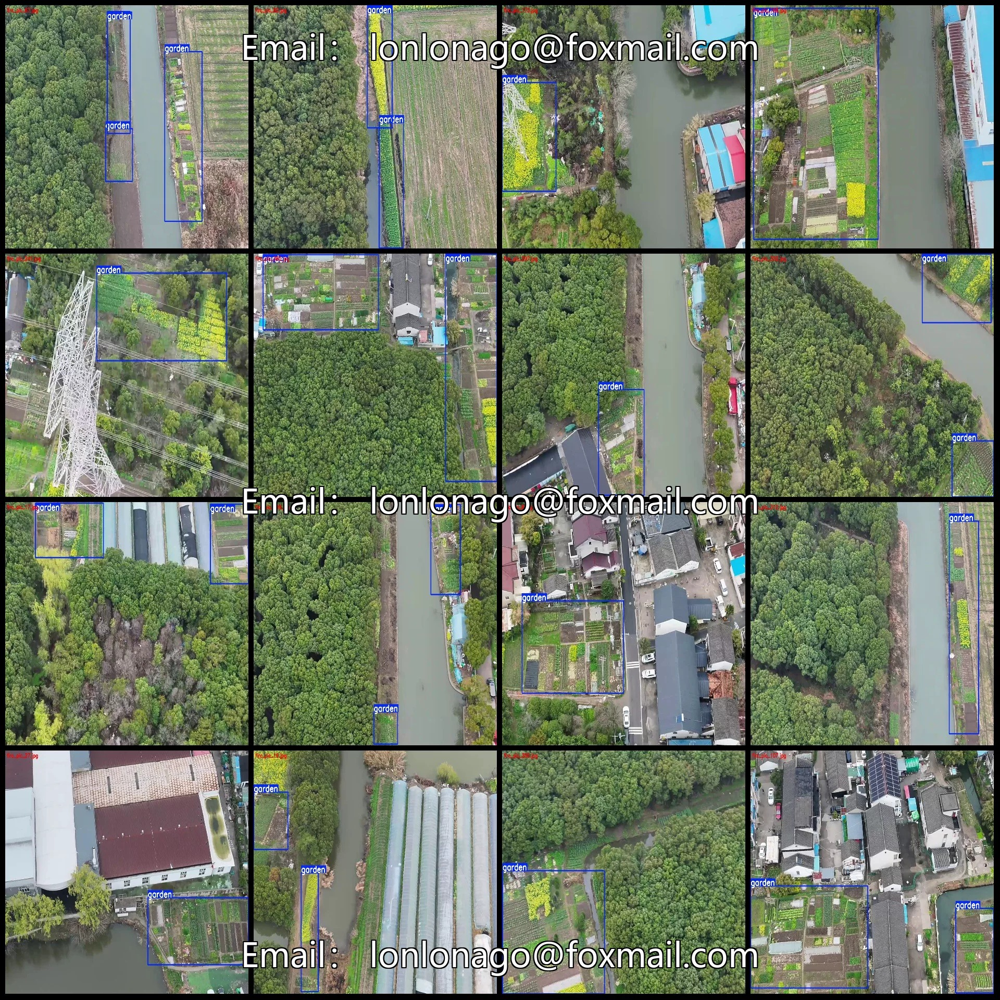
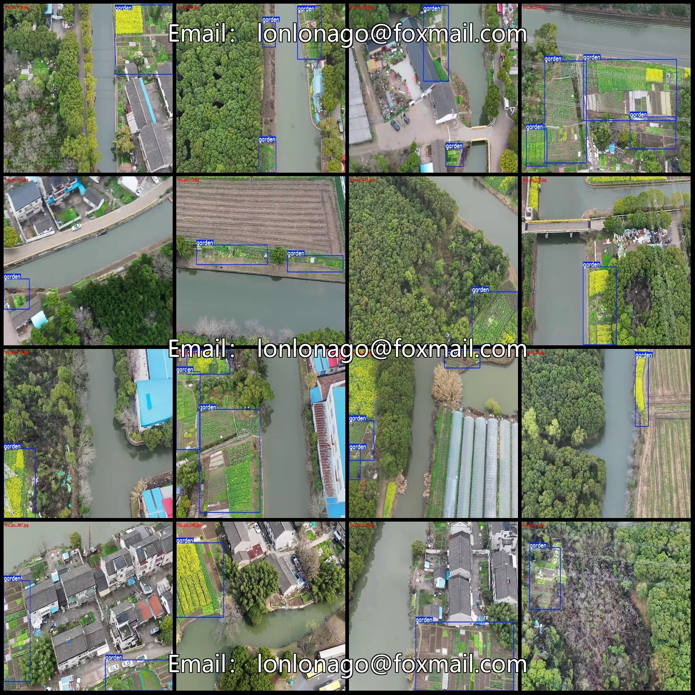
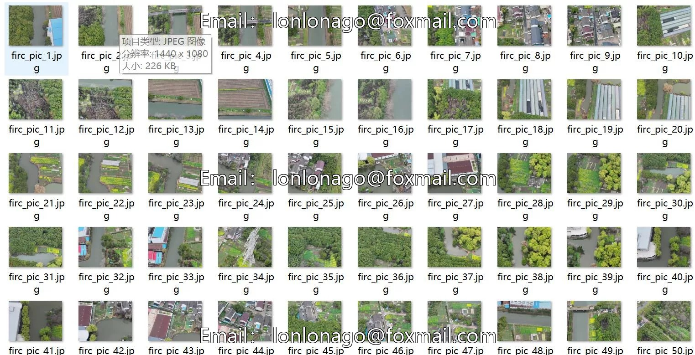
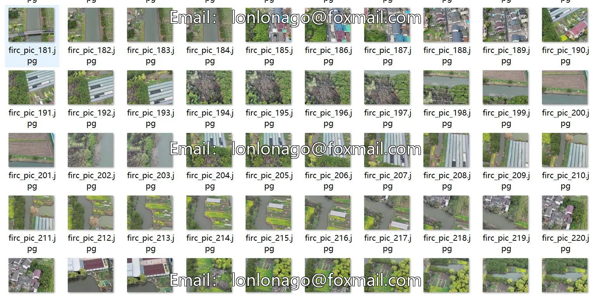
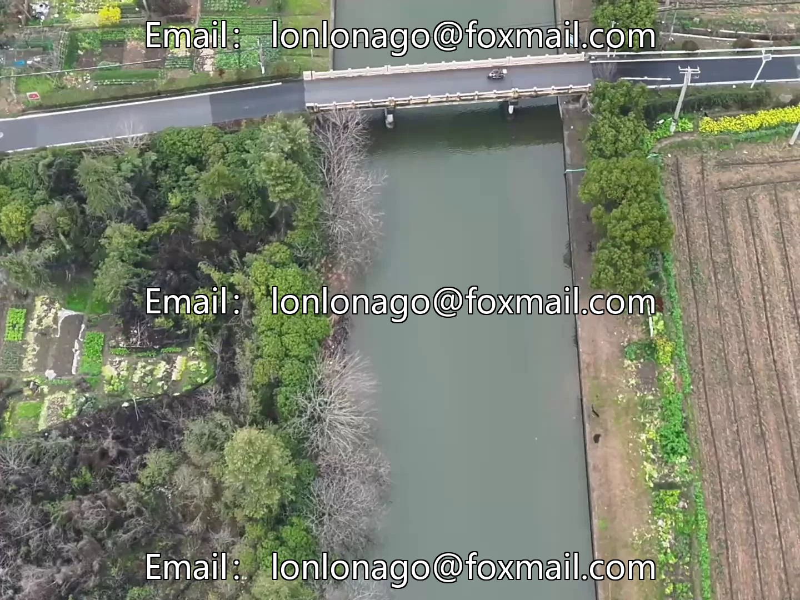
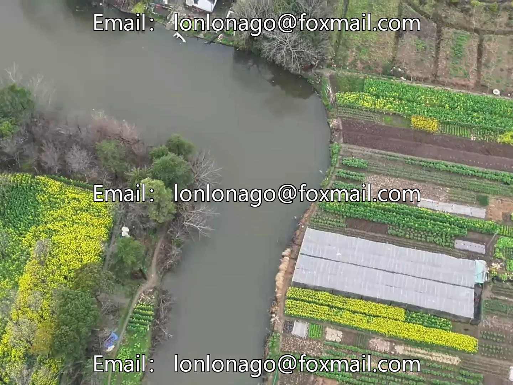
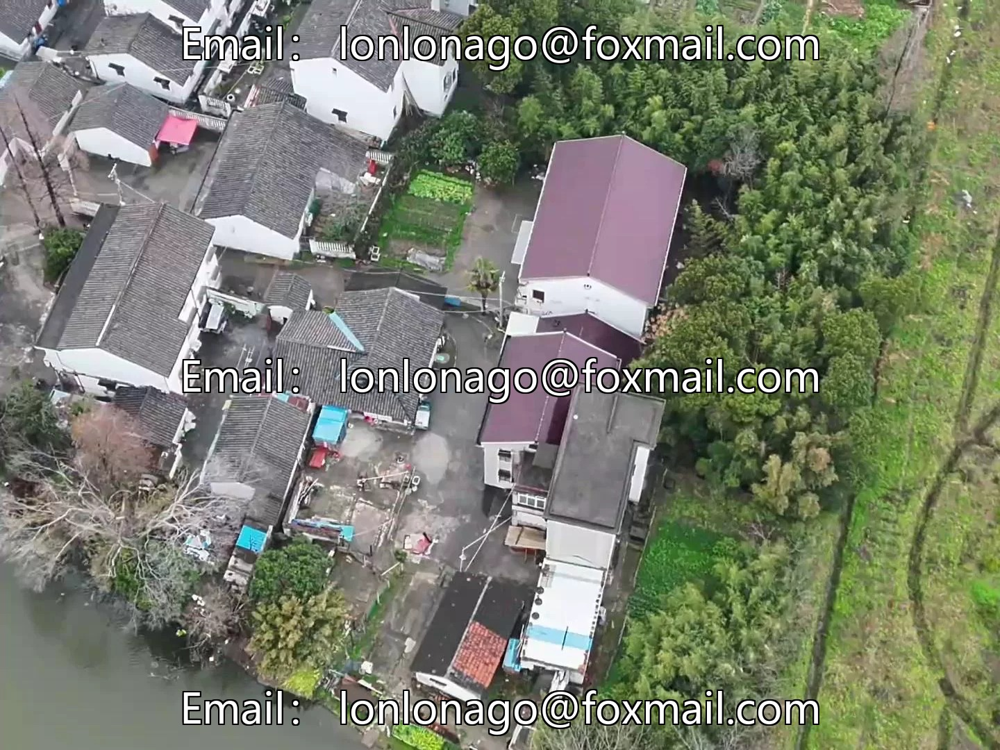

# Drone-view aerial photography dataset of vegetable gardens around rivers in VOC+YOLO format

## Body

422 annotations for a drone-viewed aerial photo dataset of vegetable gardens around rivers, in VOC+YOLO format with 1 category.

Please note: Due to the dataset's reproducibility, after purchase, please confirm that it meets the requirements before purchasing.

Dataset format: Pascal VOC format + YOLO format (excluding split paths in txt files, only including jpg images and corresponding VOC format xml files and yolo format txt files.)
Number of images (number of jpg files): 422
Number of annotations (number of xml files): 422
Number of annotations (number of txt files): 422
Number of categories: 1
Category names: ["garden"]

Garden Frames = 752, occupied by images = 422
Total Frames: 752
Image Resolution: 1440x1080
Labeling Tool: labelImg
Labeling Rules: Draw a rectangle around the category.
Important Notice: The dataset does not have splits for training, validation, and testing; you need to manually divide it.
Special Remark: This dataset does not guarantee the accuracy of the trained models or weight files.

## Images

## Payment

Here is a pay link on Stripe ( https://buy.stripe.com/3cs8yP7sY87d0vu9AB ). Please contact me lonlonago@foxmail.com after funding $89, and I will send you a complete data files , thank you!

